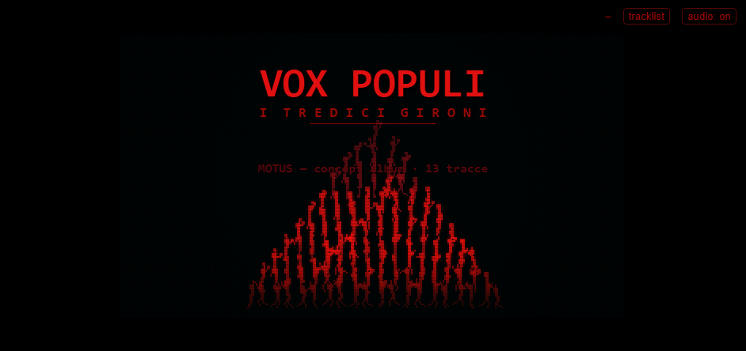
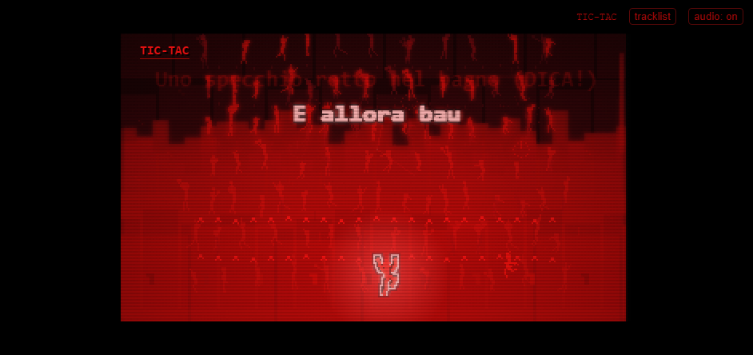
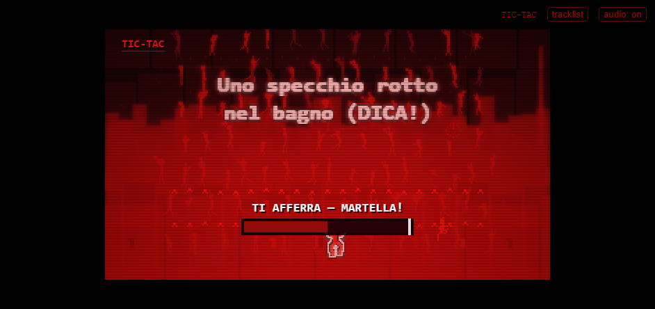
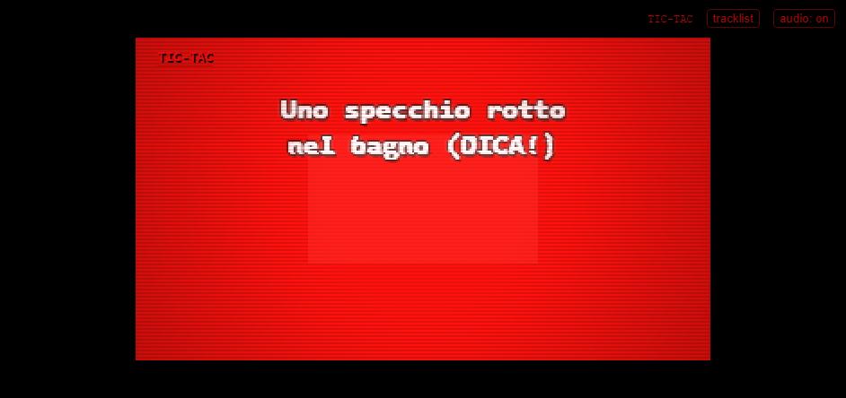

<div align="center">

# VOX POPULI
### I Tredici Gironi

**Un gioco-preview per l'album _VOX POPULI_ dei MOTUS.**
Tredici tracce, tredici gironi. Si sale — o si scende — dentro una piramide di persone,
una canzone per livello, mentre la lirica scorre al tempo del disco.

`pixel art` · `nero + rosso` · `single-file` · `zero dipendenze` · `deterministico`

<br/>



</div>

---

## Il concept

La copertina dell'album è una montagna umana: un popolo che si arrampica su sé stesso.
_VOX POPULI — I Tredici Gironi_ rende quella copertina giocabile.

Ogni girone è **un brano**. Mentre la traccia suona, il corpo sale le mensole della
piramide; la **lirica** appare sincronizzata alla voce. Lungo la salita incontri persone —
chi ti tende la mano, chi ti spinge giù, chi ti afferra — e con **due soli verbi**,
`TENDI` e `SPINGI`, decidi che popolo vuoi essere.

La lealtà che accumuli non è cosmetica: **determina quante persone reggono la piramide**
nel finale. Alla fine, la struttura crolla — e quello che resta è il popolo che hai scelto.

> Il gioco insegna senza testo. Ogni meccanica ha il suo momento "a prova di stupido".

---

## Screenshot

<table>
<tr>
<td width="50%">

**Salita con lirica sincronizzata**


</td>
<td width="50%">

**Un incontro — la lotta a martello**


</td>
</tr>
<tr>
<td width="50%">

**Il girone completato — la transizione**


</td>
<td width="50%">

**La fine: la piramide cede**


</td>
</tr>
</table>

---

## Come si gioca

| Azione | Tastiera | Touch |
|---|---|---|
| Sali / scendi di una fila | `↑` / `↓` (o `W`/`S`, `Spazio`) | ▲ / ▼ |
| Sposta una mano di lato | `←` / `→` (o `A`/`D`) | ◀ / ▶ |
| **TENDI** — ti connetti, aiuti, accetti | `Z` | bottone `TENDI` |
| **SPINGI** — prevarichi, ignori, calpesti | `X` | bottone `SPINGI` |
| Lotta | martella `Z/X/Spazio/↑` | martella |

Sulla parete la **mano che raggiunge** un appiglio brilla: è il segnale del ciclo di scalata.
Gli incontri scattano **per fila** (non puoi mancarli): la figura che incontri ti ferma finché
non scegli. Alcuni aiuti sono automatici — c'è chi ti tira su senza chiedere nulla.

---

## I Tredici Gironi

| # | Girone | Tema |
|---|---|---|
| 01 | **INTRO** | ci si sveglia dentro la notte |
| 02 | **IL VENTO DAL SUD** | il vento ti sposta di lato |
| 03 | **COME I TUONI** | il tuono stordisce e ti scrolla |
| 04 | **BAGHDAD** | detriti che cadono, uno scudo di cranio |
| 05 | **HO SONNO** | la luce cala, Morfeo ti culla |
| 06 | **PRIMO POSTO** | rivali che ti scavalcano |
| 07 | **TIC-TAC** | il tempo stringe, la cadenza accelera |
| 08 | **TUTTO FINTO** | appigli finti e fiamme |
| 09 | **EDERA** | **si scende** verso l'ade, l'edera ti tira |
| 10 | **SCENDI** | pioggia scivolosa, spintoni |
| 11 | **LA FINE DEL MONDO** | l'acqua sale, lame dal cielo |
| 12 | **MARANATHA** | il coro ti solleva |
| 13 | **OUTRO** | la cima: tutti insieme |

Ogni girone ha la sua **firma meccanica** (nessun copia-incolla), la sua **identità visiva**
(particelle, parallasse, palette, scene NPC) e il suo **feel di scalata** (velocità delle mani,
distanza del bacino, densità di appigli deboli).

---

## Com'è fatto

Il gioco è **un solo file HTML**, senza build step né dipendenze a runtime.
Sotto, i moduli ES puri vengono concatenati in un'unica IIFE da `tools/build.mjs`,
con un **guard di sintassi** che impedisce collisioni di nomi tra moduli.

```
src/
  palette.js      solo nero + rampa di rosso, come la copertina
  climb.js        arrampicata a due mani (IK, presa, ciclo)
  figure.js       scheletro umano: pose, IK a 2 segmenti, ragdoll
  encounters.js   TENDI / SPINGI — chi incontri e cosa ne nasce
  threats.js      pericoli e aiuti specifici di ogni brano
  modifiers.js    moduli tematici per girone (vento, tuoni, sonno, ...)
  themes.js       identità visiva delle 13 tracce
  karaoke.js      lirica sincronizzata (ancorata all'onset della parola)
  collapse.js     il finale: la piramide crolla in fisica ragdoll
  art.js          tutto il disegno pixel + HUD
  main.js         orchestrazione, loop, camera, juice
tools/
  build.mjs            bundle single-file + guard
  align-core.mjs       allineamento lirica (anchor + riempimento)
  align-karaoke.mjs    genera src/karaoke.js dai testi ufficiali
  clip-durations.mjs   single source delle durate
  slice-audio.mjs      estrae le clip dalle tracce
  verify.mjs           build + test + screenshot + FPS
  shots.mjs            screenshot per questo README
```

### Principi

- **Zero allocazioni nel loop.** La prestazione è parte dello stile.
- **Deterministico.** Nessun `Math.random`: stesso disco, stessa piramide.
- **La silhouette comanda.** Se in nero non si legge, non si shippa.
- **Rosso = solo il critico.** La folla resta nella metà bassa della rampa,
  così il soggetto acceso sei tu.

---

## Sviluppo

```bash
npm test        # 317 test (node --test)
npm run build   # genera VOX_POPULI_GIOCO.html (single-file)
npm run serve   # http://localhost:5173 (dev, moduli non bundlati)
node tools/verify.mjs 01   # build + test + screenshot + FPS
```

Debug rapido via query string:

- `?g=07` — parti dal girone 7
- `?collapse=2` — ferma il finale a una fase
- `?phase=mash` / `?phase=unlocked` — ispeziona quelle scene

---

<div align="center">

**VOX POPULI** non è un gioco *sull'album*: è l'album, reso giocabile.
Sali. Guarda chi ti sta intorno. Scegli.

`MOTUS — concept album · 13 tracce`

</div>
